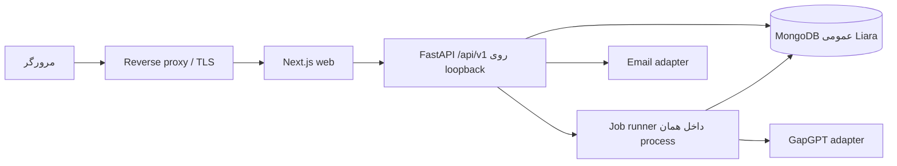

# معماری مونولیت ماژولار

ذخیره‌سازی جاری [MongoDB واقعی](24-mongodb-storage.md) روی endpoint عمومی است؛ حتی در اجرای localhost. یک process API و job runner داخل آن حفظ شده‌اند. خطای اتصال fallback ندارد.

## نمای اجرا



Web و backend دو runtime ضروری‌اند؛ دامنه در یک برنامهٔ Python و MongoDB مشترک است. API و job runner فعلاً یک process دارند. Docker/Mongo محلی لازم نیستند. Redis، Celery، Kafka و vector DB اضافه نمی‌شوند. worker جدا یا چند instance بدون lease و آزمون جدا پشتیبانی نمی‌شوند. frontend به DB یا provider مدل دسترسی ندارد.

در استقرار [Docker لیارا](25-liara-docker.md)، ورودی TLS به Next روی پورت3000 می‌رود؛ Next مسیر `/api/v1/*` را به FastAPI داخلی روی `127.0.0.1:8000` proxy می‌کند. دو runtime در یک کانتینر با launcher و shutdown مشترک‌اند؛ یک API process و یک instance، بدون overlap انتشار. CORS برای هم‌مبدأ لازم نیست؛ در dev نیز proxy هم‌مبدأ است. تصمیم‌های اصلی کسب‌وکار، هویت و مجوزها در FastAPI باشند؛ Route Handlerهای Next لایهٔ دوم auth یا API موازی نسازند. در SSR با forwarding صریح cookie فقط به backend داخلی مجاز درخواست بده و پاسخ شخصی را `no-store` کن.

در startup کانتینر، API و worker داخلی نخست آماده می‌شوند؛ تنها پس از readiness مستقیم API، فرانت شروع می‌شود. health check پیش از probe مسیر Next، API مستقیم را بررسی می‌کند تا نبود upstream در مرحلهٔ initialization به خطای proxy تبدیل نشود.

## ساختار پیشنهادی

```text
apps/
  web/
    src/app/(public)/
    src/app/(auth)/
    src/app/(user)/app/
    src/app/(admin)/admin/
    src/features/{auth,check-in,recommendations,experiences,journey,admin}/
    src/components/ui/
    src/lib/{api,i18n,validation}/
    src/styles/
  api/
    pyproject.toml
    app/main.py
    app/core/{config,db,errors,clock,security,logging}.py
    app/modules/<module>/{router,schemas,service,repository}.py
    app/jobs/{runner,leases}.py
    app/providers/{llm,email}/
    app/cli/
    tests/{unit,integration}/
packages/contracts/           # خروجی تولیدشده از OpenAPI؛ تعریف دستی دوم ممنوع
seed/                         # importer و دادهٔ تبدیل‌شده از content/
infra/{compose,proxy}/
tests/e2e/
docs/
content/
```

مسیرها الگو هستند، نیازی به فایل خالی برای هر اسم نیست. dependency lockfileهای Python و Node، `.env.example`، migrations و README اجرا هنگام پیاده‌سازی اضافه شوند.

## مرز ماژول‌ها

| ماژول | مالکیت | API داخلی اصلی |
| --- | --- | --- |
| identity | users, sessions, reset/verify tokens | current principal، session lifecycle |
| profiles | preferences | read effective preferences |
| catalog | activities, revisions | eligible published catalog، revisions |
| recommendations | check-ins, recommendation sessions | create slate، replace slot |
| experiences | experiences, feedback, saved | start، complete، cancel، feedback |
| gamification | ledger, badges, progress | award from completion transaction |
| content | jobs, prompt versions | cook، validate، review |
| admin | authorization façade, audit | call owner services |
| analytics | event batches, aggregates | ingest، aggregate |

هر repository فقط داده‌های ماژول خودش را می‌نویسد. service ماژول دیگر از interface داخلی استفاده کند؛router یا store خام یکدیگر را import نکنند. هماهنگی پایان تجربه در application service و یک atomic block مشترک انجام شود؛session و transaction واقعی Mongo همراه قفل محلی و سند محافظ مشترک، rollback و هم‌زمانی را تأمین می‌کنند. وابستگی core به domain modules ممنوع. برای این اندازه،message bus درون‌برنامه‌ای عمومی نساز.

factory در `app/core/storage.py` فقط MongoDocumentStore می‌سازد؛ پیاده‌سازی در `core/mongo.py` است. PyMongo قفل‌شده و `.env` سرور لازم‌اند. atomic همگام و بدون await/فراخوانی مدل است؛ عملیات همگام DB از event loop اصلی جدا اجرا می‌شوند. ranking تابع snapshot و clock تزریق‌پذیر باقی است. double حافظه‌ای فقط در پوشهٔ تست قرار دارد.

## پایداری و هم‌زمانی

داده‌های محصول با restart حفظ می‌شوند؛ CSRF_HMAC_SECRET ثابت است و import موجودی را بازنویسی نمی‌کند. MongoDB باید writable replica-set primary باشد؛ startup قابلیت transaction واقعی را پیش از seed می‌سنجد. TTL برای cleanup است و اعتبار زمانی در برنامه کنترل می‌شود.

queuedها پس از restart ادامه می‌یابند؛ running از فرایند متوقف با WORKER_INTERRUPTED failed می‌شود تا درخواست مدل با نتیجه/هزینهٔ نامعلوم تکرار نشود. worker همچنان تک‌پردازشی است و lease چند instance تحویل نشده است. فراخوانی مدل خارج atomic انجام می‌شود.

پایان و publish دارای transaction، idempotency، قید یکتا و کنترل نسخه‌اند. خطای بدنهٔ transaction پاسخ503 می‌دهد؛ retry درخواست همان کلید قبلی را نگه می‌دارد. جزئیات retry و محدودیت تأیید زنده در سند24 است.
